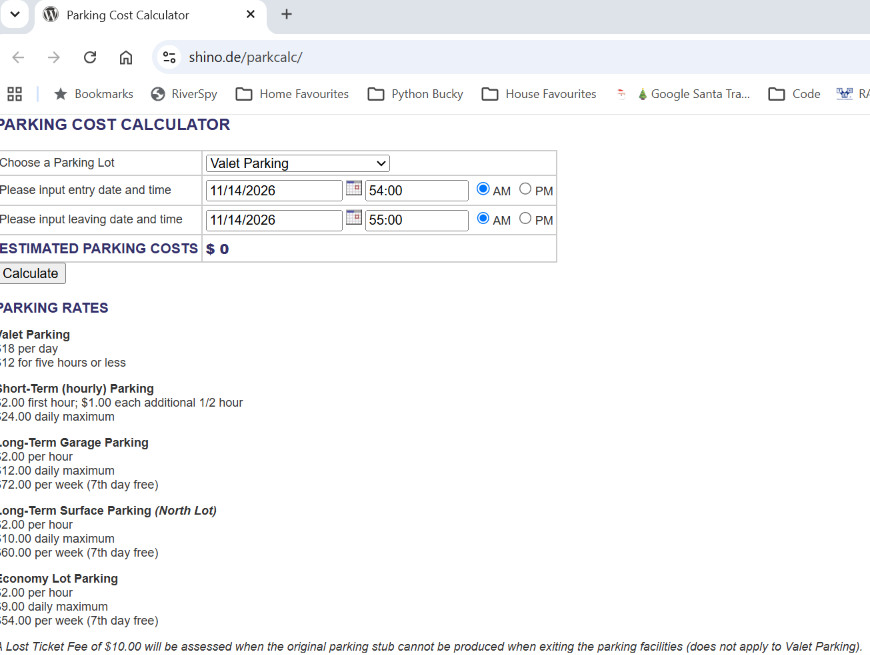
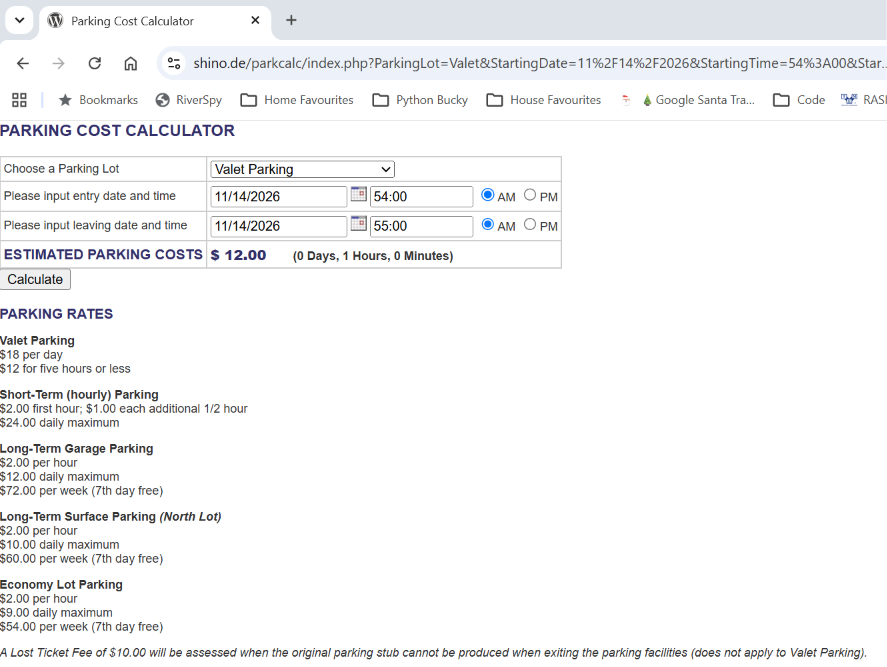
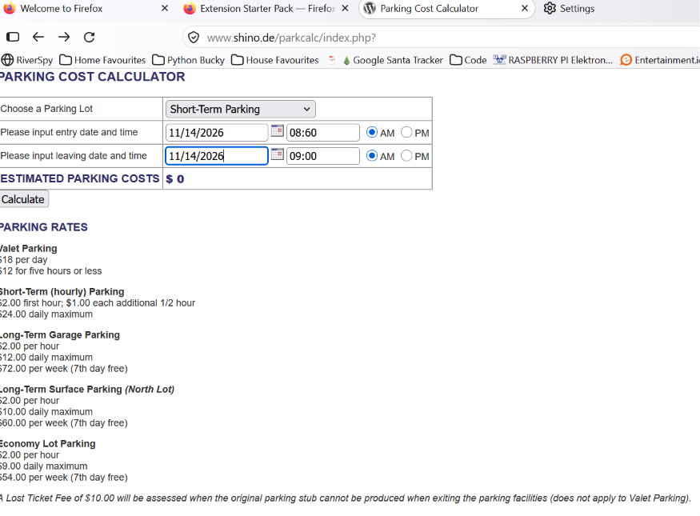
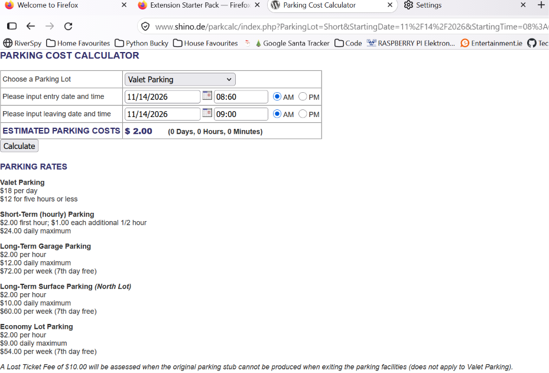
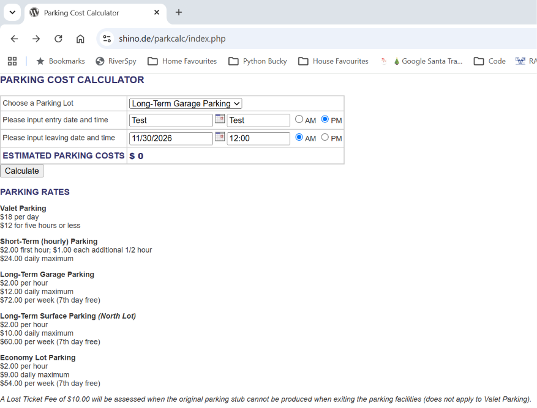
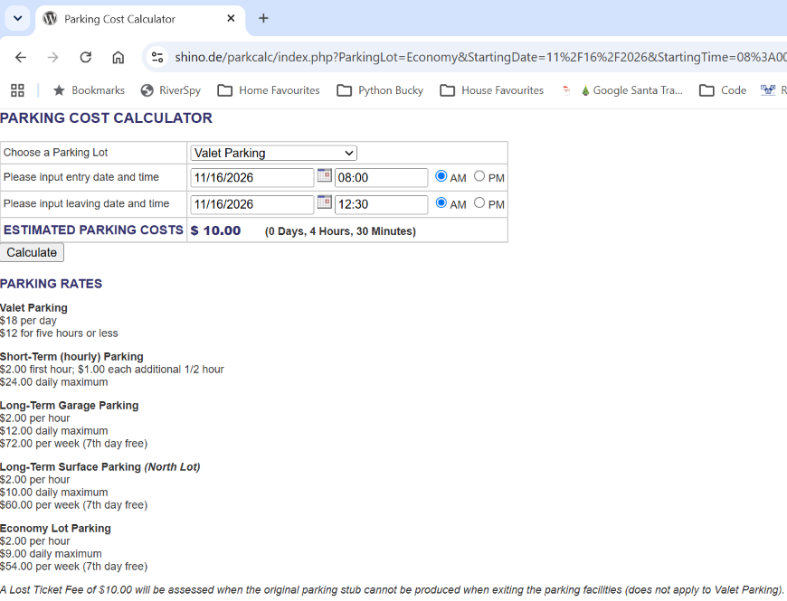
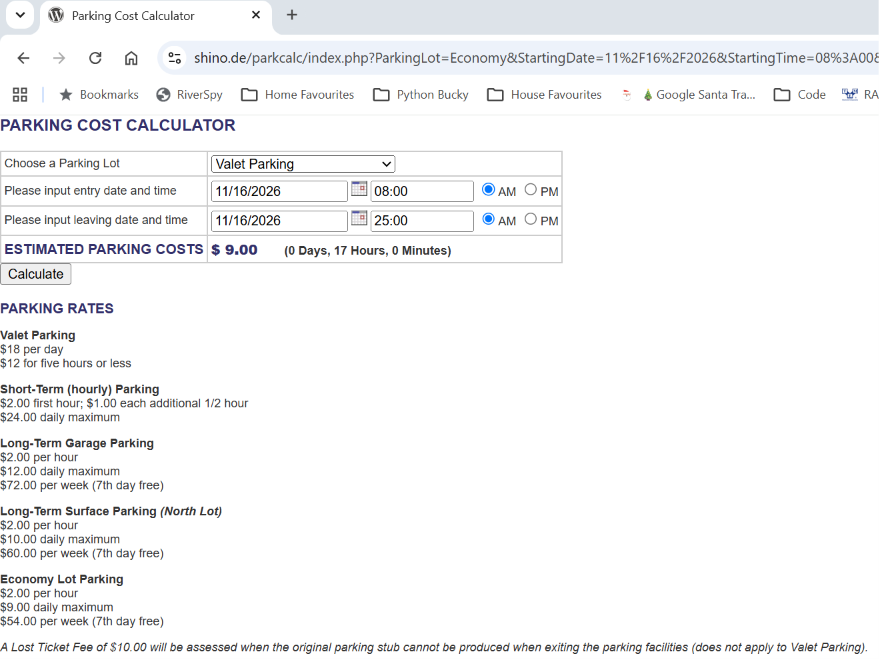

# BUG-001: Parking calculator accepts invalid time values

| Field | Details |
|---|---|
| **Application** | Shino Parking Calculator |
| **URL** | https://www.shino.de/parkcalc/ |
| **Browser** | Google Chrome 157.0.0.0|
| **Operating System** | Windows |
| **Severity** | Major |
| **Priority** | High |
| **Status** | New |

## Preconditions
The Shino Parking Calculator is open.

## Steps to Reproduce
1. Select **Valet Parking**.
2. Enter `11/14/2026` as the starting date.
3. Enter `54:00` as the starting time.
4. Select `AM`.
5. Enter `11/14/2026` as the leaving date.
6. Enter `55:00` as the leaving time.
7. Select `AM`.
8. Click **Calculate**.

## Actual Result
The application accepts both invalid time values, calculates a parking duration of one hour and returns a parking charge.

## Expected Result
The application should reject invalid time values and display an appropriate validation message.

The 12-hour clock input should only accept hours from `01–12` and minutes from `00–59`.

## Reproducibility
To be confirmed by repeating the test.

## Evidence

### Invalid time inputs

### Calculator accepts invalid times

# BUG-002: Parking calculator accepts invalid minute values

| Field | Details |
|---|---|
| **Application** | Shino Parking Calculator |
| **URL** | https://www.shino.de/parkcalc/ |
| **Browser** | Firefox Version 160.0 |
| **Operating System** | Windows |
| **Severity** | Major |
| **Priority** | High |
| **Status** | New |

## Preconditions
The Shino Parking Calculator is open.

## Steps to Reproduce
1. Select **Short-Term Parking**.
2. Enter `11/14/2026` as the starting date.
3. Enter `08:60` as the starting time.
4. Select `AM`.
5. Enter `11/14/2026` as the leaving date.
6. Enter `09:00` as the leaving time.
7. Select `AM`.
8. Click **Calculate**.

## Actual Result
The application accepts the invalid starting time of `08:60` and calculates a parking duration of one hour.

## Expected Result
The application should reject the invalid minute value and display an appropriate validation message.

Minute values should be restricted to `00–59`.

## Evidence

### Invalid minute input

### Calculator accepts invalid minute value

# BUG-003: Application displays a blank page instead of meaningful validation feedback when invalid input is submitted

| Field | Details |
|---|---|
| **Application** | Shino Parking Calculator |
| **URL** | https://www.shino.de/parkcalc/ |
| **Browser** | Google Chrome 157.0.0.0 |
| **Operating System** | Windows |
| **Severity** | Critical |
| **Priority** | High |
| **Status** | New |

## Preconditions
The Shino Parking Calculator is open.

## Steps to Reproduce
1. Open the Shino Parking Calculator.
2. Enter invalid or incomplete parking information.
3. Click **Calculate**.

## Actual Result
The application displays a blank page instead of providing validation feedback or explaining which input is invalid or missing.

## Expected Result
The application should validate the submitted information and display a clear, user-friendly error message identifying the invalid or missing input.

The calculator should remain accessible so that the user can correct the information and submit the calculation again.

## Impact
Users receive no indication of why their calculation failed and cannot easily determine how to correct their input. This creates a poor user experience and makes the application appear unstable.

## Evidence

### Invalid input submitted

### Blank page returned

# BUG-004: Economy Parking – Incorrect parking charges calculated for half-hour durations

| Field | Details |
|---|---|
| **Application** | Shino Parking Calculator |
| **URL** | https://www.shino.de/parkcalc/ |
| **Browser** | Google Chrome 157.0.0.0 |
| **Operating System** | Windows |
| **Severity** | High |
| **Priority** | High |
| **Status** | New |

## Preconditions

The Shino Parking Calculator is open.

## Steps to Reproduce

1. Select Economy Parking.
2. Set the entry date to 16 November 2026.
3. Set the entry time to 08:00 AM.
4. Set the leaving date to 16 November 2026.
5. Set the leaving time to 12:30 PM.
6. Click Calculate.
7. Repeat the calculation with a leaving time of 01:00 PM.

## Actual Result

The application returns inconsistent parking charges:

| Parking duration | Actual charge |
|---|---:|
| 4 hours 30 minutes | $10.00 |
| 5 hours | $9.00 |

The application also appears to alter the entered leaving time when processing the half-hour values.

## Expected Result

Economy Parking has a displayed daily maximum of $9.00.

The application should not calculate a charge exceeding this daily maximum for a single day's parking.

The expected charge for both scenarios is $9.00.

The entered leaving time should also be retained accurately.

## Impact

Customers may be charged more than the advertised daily maximum. Inconsistent calculations undermine confidence in the parking calculator and could result in incorrect parking charges.

## Evidence

### 4 hours 30 minutes – $10.00 returned

### 5 hours – $9.00 returned

